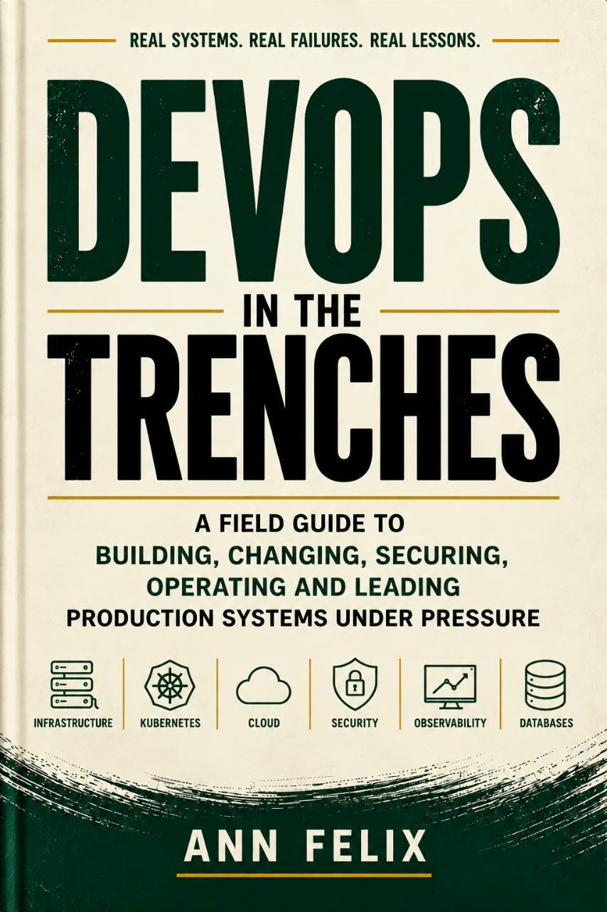
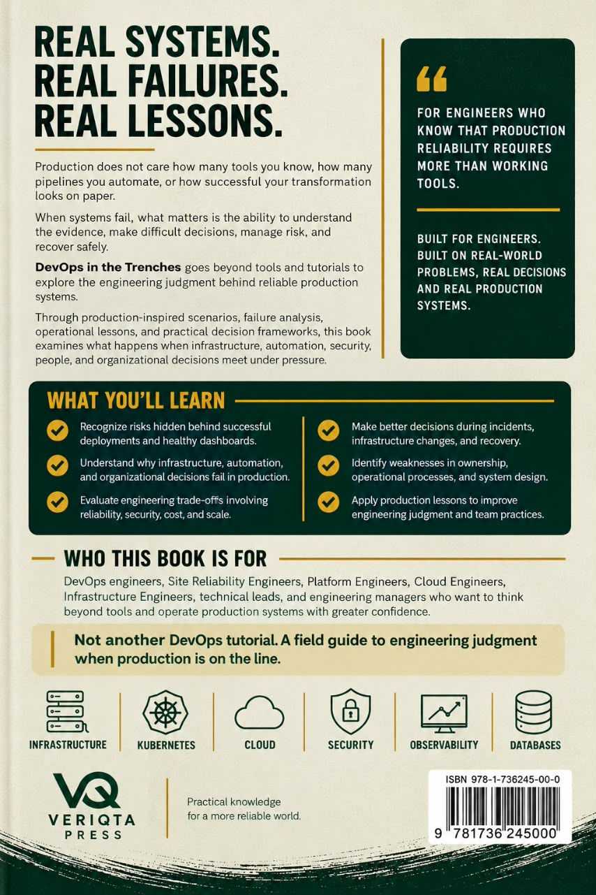

  

<strong>By Ann Ogechi Felix · Published by VERIQTA PRESS</strong>

<a href="https://veriqtapress.com">Official book website</a> · <a href="https://github.com/veriqta/devops-in-trenches/tree/main/Chapter">Read free sample chapters</a>

# DevOps in the Trenches

**A field guide to building, changing, securing, operating, and leading production systems under pressure.**

Production does not care how many tools you know or how successful a deployment looks on paper. When systems fail, the important questions become harder: What does the evidence tell us? Who owns the decision? How far can the failure spread? What is the safest path to recovery?

*DevOps in the Trenches* explores the engineering judgment behind reliable production systems. Through production-inspired situations, operational lessons, and difficult trade-offs, it examines what happens when infrastructure, automation, security, people, and organizational decisions meet under pressure.

This repository is the **official public companion** to the book. It provides selected reading material and a direct route to the publication. **The complete manuscript is not published here.**

## The book

  
  &nbsp;&nbsp;
  

**Author:** Ann Ogechi Felix  
**Publisher:** VERIQTA PRESS  
**Status:** Coming soon  
**Official website:** https://veriqtapress.com

## What the book explores

- **Failures behind healthy dashboards:** How apparently successful changes can conceal operational risk.
- **Engineering trade-offs:** Reliability, security, cost, performance, and scale rarely improve independently.
- **Change under control:** The limits of automation, the importance of evidence, and the discipline of safe delivery.
- **Systems in production:** Cloud infrastructure, platforms, Kubernetes, networks, data, and recovery.
- **Operating under pressure:** Incident decisions, communication, containment, restoration, and learning.
- **Ownership and leadership:** How technical responsibility and organizational decisions shape production outcomes.

## Read free sample chapters

**[Explore the official sample chapter directory →](https://github.com/veriqta/devops-in-trenches/tree/main/Chapter)**

The `Chapter/` directory contains the publicly available reading material. These samples introduce the book's approach; they are **not** the complete 63-chapter publication. The directory path is intentionally preserved because it is linked from the official website.

## Inside the book

The full book is organized into **63 chapters across 12 parts**:

| Part | Focus |
|:---:|---|
| I | Seeing Production Clearly |
| II | Ownership, Teams, and Decision Rights |
| III | Designing for Operability |
| IV | Moving Change Without Losing Control |
| V | Trusted Automation and Software Supply Chains |
| VI | Platforms, Cloud Foundations, and Compute |
| VII | Kubernetes, Networks, and Distributed Integration |
| VIII | Data, Storage, and Recovery |
| IX | Security, Identity, and Compliance in Delivery |
| X | Reliability Engineering Before the Incident |
| XI | Operating Under Pressure |
| XII | Leading the Whole System |

The book is written for DevOps, site reliability, platform, cloud, infrastructure, security, and software engineers, as well as architects and technical leaders who make decisions about production systems.

## About the author

Ann Felix is a Senior DevOps Engineer, technical author, and founder of VERIQTA, an engineering education brand focused on DevOps, cloud computing, site reliability, and platform engineering.

Her work focuses on making complex engineering concepts accessible while emphasizing the operational realities, technical decisions, and challenges engineers encounter in production environments.

As the author of *DevOps in the Trenches*, Ann explores production-inspired failures, engineering trade-offs, and the judgment required to build and operate reliable systems.

She also leads VERIQTA PRESS, a publishing imprint dedicated to practical engineering books, technical knowledge, and professional development.

## Publication and availability

**Coming soon.** For the official publication information and future purchase availability, visit **[veriqtapress.com](https://veriqtapress.com)**. No checkout or preorder is offered through this repository.

## Copyright and permitted use

**© 2026 Ann Felix. All rights reserved.** This is a **publicly accessible, proprietary book repository**, not an open-source or open-content publication. Access to the sample material does not grant permission to reproduce, distribute, adapt, translate, train AI models on, resell, or commercially exploit the material. Linking to the public repository is welcome. Rights and exceptions provided by applicable law remain unaffected.

See the **[full copyright and permissions notice](COPYRIGHT.md)**. For licensing requests: **devops-in-the-trenches@veriqta.com**.

---

<strong>VERIQTA PRESS</strong> REAL SYSTEMS. REAL FAILURES. REAL LESSONS. <a href="https://veriqtapress.com">veriqtapress.com</a>

